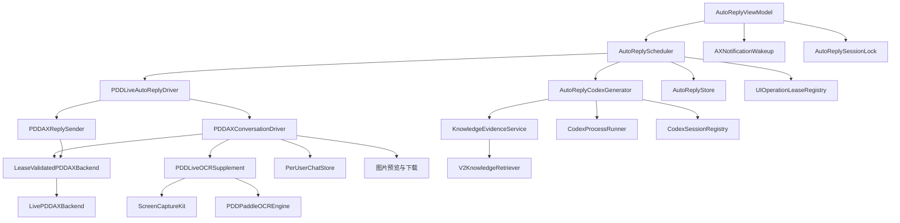
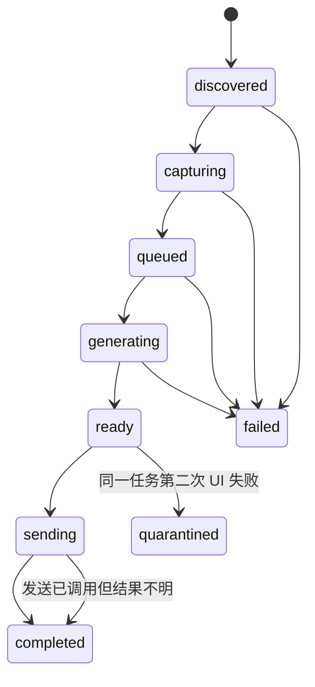

# 拼多多全自动客服：代码级架构与调试交接手册

> 文档日期：2026-09-01  
> 对应工程：`PDDAXReader`  
> 工程根目录：`/Users/scy/Documents/Codex/2026-08-27/ax-ax-ax`  
> 当前重点交付物：`outputs/拼多多全自动客服-任务隔离候选版.app`  
> 读者：接手开发、现场调试、故障定位和后续维护的工程师

## 0. 文档定位与事实边界

本文是按 **2026-09-01 当前源码** 反向整理的代码级交接文档，不是早期设计稿，也不承诺早期计划中的每项设想都已落地。若本文与 `docs/superpowers/specs/`、`docs/superpowers/plans/` 中的历史文档冲突，应依次以以下内容为准：

1. 当前 `Sources/PDDAXReader/` 源码；
2. 当前 `Tests/PDDAXReaderTests/` 自动测试；
3. 本文对当前实现的解释；
4. 历史设计与计划文档。

用户此前看到程序停止的一次情况已确认是 **人工手动停止**，不能当成调度器自动卡死或崩溃证据。

本文已合入 2026-09-01 的千牛内核对齐修改：schema 4、事务 checkpoint、持久尾部补采、generation-first/三发送公平、指数重试与 backpressure、内容寻址图片、统一提示词、独立 `CODEX_HOME`、增量 UID session、常驻 V2 worker 与持久运行意图。下载器的 20 MB 限制仍发生在整包下载之后，这是仍需处理的真实缺口。

---

## 1. 五分钟接手清单

### 1.1 环境要求

- macOS 14 或更高；
- Xcode / Swift 5.9 工具链；
- 拼多多商家工作台 bundle ID 为 `com.pinduoduo.merchantMac`；
- 本程序需要辅助功能权限和屏幕录制权限；
- Codex CLI 已登录 ChatGPT，`codex login status` 输出需包含 `Logged in using ChatGPT`；
- V2 知识检索器目前固定寻找 Python 3.12：`/Library/Frameworks/Python.framework/Versions/3.12/bin/python3.12`。

### 1.2 首轮只读检查

```bash
cd /Users/scy/Documents/Codex/2026-08-27/ax-ax-ax
swift test
zsh scripts/verify_task_isolation_candidate.sh
```

查看候选版运行数据：

```bash
open "$HOME/Library/Application Support/PDDAutoReplyTaskIsolationCandidate/拼多多AX记录-任务隔离候选版"
```

查看核心状态：

```bash
python3 -m json.tool "$HOME/Library/Application Support/PDDAutoReplyTaskIsolationCandidate/拼多多AX记录-任务隔离候选版/state.json"
```

### 1.3 构建候选版

```bash
zsh scripts/build_app.sh --task-isolation-candidate
zsh scripts/verify_task_isolation_candidate.sh
```

构建脚本会先把已有候选 app 移入 `outputs/backups/<时间戳>/`，再构建 release 二进制、复制资源并使用 Apple Development 身份签名。它不会清除候选版运行数据。

### 1.4 启动前必须知道的事实

- 候选版打开后默认保持停止，必须在 UI 中点击“开始”；旧正式自动回复版会在界面出现后自动启动。
- “演练模式”关闭时才会真正发送；当前产品目标是正式自动回复。
- 所有 app 变体共用一份 Swift executable target，但通过 bundle ID / executable name 选择模式。
- legacy 自动回复和候选版使用不同数据根目录，但使用共同的 session lock，设计上不允许同时控制拼多多 UI。
- 程序停止后没有后台 daemon；UI 中停止或退出 app 就不会继续自动回复。

---

## 2. 工程目录和模块地图

```text
ax-ax-ax/
├── Package.swift                         SwiftPM 定义，macOS 14，单 executable target
├── Sources/PDDAXReader/                  全部 Swift 生产代码
├── Tests/PDDAXReaderTests/               XCTest 单元/集成测试
├── Tests/FaultInjection/                 定时重复故障矩阵
├── Tests/PackagingTests/                 app 资源打包检查
├── Resources/
│   ├── *Info.plist                       四种 app 身份
│   ├── WebOCR/                           PaddleOCR + ONNX Runtime 离线资源
│   ├── CustomerService/                  客服提示词资源
│   ├── V2Knowledge/                      Python 检索脚本、依赖、向量缓存
│   ├── KnowledgeBase/                    知识库 ZIP
│   └── reply-output.schema.json          Codex 输出 JSON Schema
├── scripts/build_app.sh                  构建、资源复制、签名
├── scripts/verify_task_isolation_candidate.sh
├── outputs/                              构建产物与候选版备份
└── docs/                                 设计、调查、验证证据与本文
```

### 2.1 生产文件职责索引

| 子系统 | 核心文件 | 主要职责 |
|---|---|---|
| app 模式 | `PDDAppMode.swift`, `PDDRuntimeIdentity.swift`, `PDDAXReaderApp.swift` | 根据 bundle 身份选 UI、数据目录、锁文件和启动策略 |
| UI | `AutoReplyView.swift`, `AutoReplyViewModel.swift`, `AutoReplyFloatingProgress.swift` | 开始/停止、权限入口、演练开关、进度展示、运行循环 |
| 调度 | `AutoReplyScheduler.swift`, `AutoReplyModels.swift` | 每用户任务、状态机、生成并发、串行 UI、发送恢复 |
| 隔离 | `UIOperationLease.swift`, `PDDLeaseValidatedBackend.swift`, `TaskFailurePolicy.swift` | UI 操作租约、撤销、超时和单任务失败隔离 |
| 持久化 | `AutoReplyStore.swift`, `AutoReplyTimeline.swift`, `PerUserChatStore.swift`, `PerUserAXStore.swift` | 状态、游标、归档、每用户聊天和 AX dump |
| AX | `PDDAXBackend.swift`, `PDDAXSemanticNode.swift`, `PDDAXControlSelection.swift` | 读取 AX tree、选择会话/输入框/发送按钮、执行 UI 操作 |
| 唤醒与稳定读取 | `AXNotificationWakeup.swift`, `StableAXTreeReader.swift` | AX 通知触发快速轮询；手动读取模式多样本稳定化 |
| OCR | `PDDOCRCapture.swift`, `PDDPaddleOCREngine.swift`, `PDDOCRChatParser.swift`, `PDDLocalResourceServer.swift` | 截图、离线 OCR、气泡左右侧解析、资源服务 |
| 未读路由 | `PDDRedDotDetector.swift`, `PDDAXConversationDriver.swift` | AX 定位行，像素识别红点，点击未读会话，捕获消息 |
| 混合消息 | `PDDChatParser.swift`, `PDDAXImageEvidence.swift`, `PerUserChatStore.swift` | OCR 文本权威、AX 图片证据、历史合并 |
| 图片 | `PDDAXImageSelection.swift`, `PDDAXImagePreview.swift`, `PDDCustomerImageDownloader.swift` | 找图片气泡、双击预览、读原图 URL、校验下载 |
| 发送 | `PDDAXReplySender.swift` | 输入草稿、复核会话与控件、点击发送、判断结果 |
| Codex | `AutoReplyCodexGenerator.swift`, `CodexInvocation.swift`, `CodexProcessRunner.swift`, `CodexSessionRegistry.swift` | 每用户线程、CLI 调用、图片附件、超时和结果 Schema |
| 知识库 | `KnowledgeEvidenceService.swift`, `V2KnowledgeRetriever.swift`, `KnowledgeResourceLocator.swift` | 组装冻结批次、调用 Python 检索、生成证据上下文 |
| 诊断 | `AutoReplyDiagnostics.swift`, `AutoReplyProgressPresentation.swift`, `RuntimeResourceMonitor.swift` | Codex/知识库诊断、UI 状态文字、资源快照 |

---

## 3. 四种 app 模式

同一个 `PDDAXReader` Swift 可执行 target 被包装成四种 `.app`。入口在 `PDDAXReaderApp.swift`，身份解析在 `PDDAppMode.swift` 与 `PDDRuntimeIdentity.swift`。

| 模式 | Bundle ID | executable | UI / 行为 |
|---|---|---|---|
| reader | `com.scy.pdd-ax-reader` | `PDDAXReader` | 手动完整读取 AX、解析、保存，必要时调用 Codex |
| single parse | `com.scy.pdd-ax-single-parse-probe` | `PDDAXSingleParseProbe` | 按一次只读取一次 chat profile，用于测 AX parse 延迟 |
| legacy auto reply | `com.scy.pdd-auto-reply` | `PDDAutoReply` | 自动回复 UI，出现后自动 start |
| task-isolation candidate | `com.scy.pdd-auto-reply.task-isolation-candidate` | `PDDTaskIsolationCandidate` | 新隔离版，出现后保持 stopped，用户手动 start |

候选版单独数据目录的目的是允许安全对比和回滚，不污染 legacy 的 `state.json`、用户聊天历史、图片和 Codex session；共同锁则阻止两个版本同时点击同一个拼多多窗口。

---

## 4. 运行时对象装配

真实自动回复对象图由 `AutoReplyViewModel.makeLiveRuntime(...)` 附近的代码组装。理解这里比从 UI 往下猜更快。



### 4.1 为什么 UI 操作只能串行

AX 读取、点会话、截图、双击图片、填写输入框和点发送都依赖“当前拼多多窗口/当前会话”这个全局可变 UI 状态。两个任务并行操作会把 A 用户的回复发给 B 用户。因此：

- `AutoReplyScheduler.pumping` 保证一次只有一个 `tick()` 执行调度决策；
- `performUI(...)` 为一次 UI 工作获取 `UIOperationLease`；
- `PDDLeaseValidatedBackend` 在 AX 调用前后验证 lease；
- UI 超时或 stop 会撤销 lease；
- Codex 生成不碰拼多多 UI，可以并行。

这就是“UI 串行，生成并发”的核心架构。

---

## 5. 启动、停止、权限与 200 ms 主循环

### 5.1 `AutoReplyViewModel.start()`

顺序如下：

1. 调用辅助功能信任检查，必要时触发系统提示；
2. 获取候选版共享锁及兼容 legacy lock；任一个失败则不启动；
3. 根据演练模式调用 `runtime.setDeliveryEnabled(!isDryRun)`；
4. `runtime.start()`；
5. 启动 AX notification observer；通知回调只请求 scheduler refresh，不直接做 UI；
6. 创建 `loopTask`，约每 200 ms 调用一次 `runtime.tick()`；
7. 刷新界面快照。

### 5.2 `stop()`

顺序如下：

1. 取消 loop task；
2. scheduler `stop()`：`isRunning=false`，清空快速扫描状态，撤销当前 UI lease；
3. 停止 AX observer；
4. 释放 session locks；
5. 刷新 UI。

stop 是可恢复的正常控制路径，不应被日志分析器自动归类为异常。

### 5.3 权限按钮

“打开所需权限”按钮检查：

- 辅助功能：`AXIsProcessTrusted()`；
- 屏幕录制：`CGPreflightScreenCaptureAccess()`。

缺失时打开相应的 `x-apple.systempreferences:` 设置页面。macOS 权限按 **签名后的 app 身份** 记录；如果换了 bundle/signature 或从不同路径启动，系统可能视为新程序。调试权限时应启动 `outputs/` 中最终签名 app，而不是只跑 `swift run`。

---

## 6. 调度器与任务状态机

核心类：`AutoReplyScheduler`。核心持久化模型位于 `AutoReplyModels.swift`。

### 6.1 Job 状态



枚举还保留 `uncertain` 状态用于旧 schema 兼容，但当前主路径把“已执行发送但无法确认”保存为：

```text
state = completed
deliveryOutcome = uncertain
```

这样该任务成为终态，游标前进，不会因为无法确认而反复发送。

### 6.2 `tick()` 的优先级

每次 tick 在 `pumping == false` 且 `isRunning == true` 时进入。处理顺序是：

1. 先按动态容量启动所有可运行的 `queued` Codex generation；
2. 连续完成 3 次发送后，强制做一次 discovery，避免新红点饥饿；
3. 否则发送最小 `sequence` 的 `ready` job；
4. 再处理一个持久化 typed capture request（ordinary/supplement/tail）；
5. 到达 discovery 时间时扫描未读；
6. 最后同步公开 jobs 供 UI 展示。

任何单任务错误由任务失败策略处理，不能把 scheduler 全局改成 stopped。

### 6.3 discovery 频率

- 普通发现间隔：1 秒；
- AX 通知唤醒后：立即把 `lastDiscoveryAt` 置为远古时间，并安排 3 次快速尝试；
- 快速发现间隔：0.2 秒；
- `pendingAXWakeCapture` 让已知当前 UID 也获得一次捕获机会。

AX 通知只是“尽快检查”的信号，不代表 AX tree 已经包含新消息。拼多多内部 WebView 的 AX tree 可能晚于 UI 像素更新，因此 OCR 是当前文本权威来源。

### 6.4 捕获和创建任务

`capture(uid:)` 的要点：

1. 读取该 UID 已回答 cursor；
2. 经 `performUI` 调 driver capture；
3. `normalizeObservation` 合并已知客服消息 ID，并主动清空 `unexpectedServiceMessageIDs`；
4. `reconcileVisibleReplies` 在可见历史中寻找旧 job reply 的精确匹配，修复“发送成功但当时未确认”的状态；
5. 如果没有冻结客户批次，可以更新 baseline/cursor；
6. 如果存在新客户批次，创建新的 `AutoReplyJob`，赋递增 `sequence`，进入 `queued`；
7. 持久化。

当前 `hasActiveJob(uid:)` 只把 `queued/generating/ready/sending` 视为活跃。`quarantined` 不会永久挡住这个 UID 的后续新任务。

### 6.5 Codex 生成重试

- `queued` 进入 `generating` 时启动独立 Task；
- 完成后回到主 actor 更新状态；
- 成功则写入 `reply`、generation diagnostic，进入 `ready`；
- 失败时 `retries += 1` 并重排；
- 普通失败 1–20 次使用 1、2、4…60 秒封顶的指数退避；
- 第 21 次失败只停放该 revision，不推进 answered cursor，也不停止其他 UID；
- 429、rate-limit、allocation/out-of-memory 会触发 60 秒并发 backpressure；
- session identity 类错误第一次要求重建 session 后重试。

这保证临时 Codex 故障不会把客户批次静默标成已回答；停放的 revision 也不属于 active job，因此后续客户仍能继续进入新任务。

### 6.6 自适应并发

`AdaptiveConcurrencyPolicy` 依据物理内存设置生成并发上限：

- 可用内存低于或等于 1 GiB 时不启动新 CLI；
- 剩余内存按约 1 个 CLI / GiB 估算；
- 不再固定最少 6、最多 24；物理内存只提供紧急上界；
- backpressure 冷却会临时将并发减半 60 秒。

---

## 7. 任务隔离、UI lease 与超时

### 7.1 lease 内容

`UIOperationLeaseRegistry.acquire(uid:)` 返回包含以下标识的 lease：

- generation；
- operation ID；
- UID；
- 对 registry 的验证闭包。

每次 acquire 都使上一代 token 失效；stop、timeout 或任务结束会 revoke。

### 7.2 `performUI(...)`

所有 scheduler 发起的 discovery/capture/preflight/send 都经过该函数：

1. 获取 lease；
2. 保存 `activeUIOperationID` 和 `currentUIOwner`；
3. 用 `OperationDeadline` 与真实操作竞速；默认 UI timeout 3 秒，passive capture 10 秒；
4. 操作前后验证 lease；
5. 无论成功或失败，都撤销 registry lease 并通知 driver 撤销对应 operation；
6. 清除 owner。

`OperationDeadline` 的实现不能只靠 Swift cooperative cancellation；它使用外部 continuation/race，保证被调操作忽略取消时调用方仍会在 deadline 后返回。

### 7.3 UI 失败策略

`TaskFailurePolicy.uiDecision(previousFailures:)`：

- 第一次 UI 失败：任务放回队尾，极短延迟后重试；
- 同一 job 第二次 UI 失败：进入 `quarantined`，释放调度器继续处理其他 UID；
- 从不返回“停止全局调度器”。

自动测试会跑 2,000 次失败矩阵，断言决策只能是 requeue 或 park。

### 7.4 必须保持的隔离不变量

修改相关代码时必须维持：

1. 同时最多一个有效 UI lease；
2. 过期 lease 不能 press/set/read；
3. timeout 后迟到任务不能继续发送；
4. 一个 UID 卡死不能停止其他 UID；
5. generation 可以并发，但 send 必须串行；
6. 一旦真实 send 调用开始，异常不得自动重发。

---

## 8. 持久化、目录与崩溃恢复

### 8.1 数据根目录

legacy 自动回复：

```text
~/Desktop/拼多多AX记录/自动回复/
```

任务隔离候选版：

```text
~/Library/Application Support/PDDAutoReplyTaskIsolationCandidate/
└── 拼多多AX记录-任务隔离候选版/
```

共享锁：

```text
~/Library/Application Support/PDDAutoReplyShared/session.lock
```

兼容检查的旧锁：

```text
~/Desktop/拼多多AX记录/自动回复/session.lock
```

### 8.2 运行数据结构

```text
<data-root>/
├── state.json
├── archive/
│   ├── records/<job-uuid>.json
│   └── replies/<job-uuid>.txt
├── 用户/
│   └── GZC-123456/
│       ├── history.jsonl
│       ├── ax.txt                  手动 reader 模式使用
│       └── codex-session.json
└── images/
    └── GZC-123456/<batch-digest>/...
```

上图就是自动回复 live runtime 的实际相对结构：`AutoReplyStore`、`PerUserChatStore`、`CodexSessionRegistry` 都直接接收 `identity.dataRoot`，图片组件接收 `identity.dataRoot/images`。legacy 的 `dataRoot` 本身已经以“自动回复”结尾，候选版则以“拼多多AX记录-任务隔离候选版”结尾，不能再额外拼一层“自动回复”。

### 8.3 `state.json` schema 4

`AutoReplyPersistentState` 主要字段：

| 字段 | 含义 |
|---|---|
| `schemaVersion` | 当前为 4 |
| `nextSequence` | 新 job 的全局顺序号 |
| `jobs` | 全部活跃与历史任务对象 |
| `answeredCursors` | 每 UID 已经消费/跳过到哪个客户事件前缀 |
| `baselinedUIDs` | 已建立初始基线的 UID |
| `knownServiceMessageIDsByUID` | 已观察到的客服消息 ID |
| `confirmedAutoReplyMessageIDsByUID` | 已确认由本程序发送的消息 ID |
| `events` | 调度事件列表，供界面和事故定位 |
| `consecutiveDeliveryCount` | 重启可恢复的三发送公平计数 |
| `pendingCaptureRequests` | 持久化 ordinary/supplement/tail 补采请求 |

Job 中最关键的发送字段：

| 字段 | 调试意义 |
|---|---|
| `state` | 当前状态机位置 |
| `capture.batch` | 本 job 冻结的客户消息批次 |
| `capture.cursor` | 捕获时的前缀游标 |
| `reply` | Codex 生成文本 |
| `deliveryOutcome` | `notSent/sent/uncertain` |
| `durableAttemptOperationID` | 本次持久化发送操作 ID |
| `sendWasInvoked` | 是否已经跨过“准备调用真实发送”边界 |
| `stageAttempt` | 当前 UI 阶段失败计数 |
| `retries` | 生成重试计数 |
| `lastError` | 最近错误 |
| `revision.digest/ordinal` | 由冻结批次 end cursor 派生的稳定 revision 身份 |

### 8.4 原子写和 archive

- `state.json` 使用 pretty + sorted keys JSON，`Data.write(..., .atomic)`；
- store 内部用锁串行化 load/save/archive；
- schema 1/2/3 文件在迁移前会创建备份，再升级为 4；
- `AutoReplyTransactionalStore` 用 checkpoint SHA 做 compare-and-commit，拒绝外部修改覆盖和 answered cursor 倒退；
- checkpoint 只保留最新 100 个 events、最新 200 个终态 UI job；
- archive record/reply 另有 byte count + SHA-256 manifest；同 ID 不同内容会拒绝覆盖。

### 8.5 启动恢复规则

`loadRecoveringInterruptedWork(now:)`：

| 崩溃时状态 | 恢复结果 |
|---|---|
| `capturing` | 回到 `discovered` |
| `generating` | 回到 `queued` |
| `sending` 且 `sendWasInvoked == false` | 回到 `ready/notSent`，清除 operation ID，可重新尝试 |
| `sending` 且 `sendWasInvoked == true` | 直接 `completed/uncertain`，推进 cursor，不重发 |

这个边界是防重复发送的关键。不得把 `sendWasInvoked=true` 的 job 简单重置到 ready。

### 8.6 每用户路径安全

`PerUserAXStore` 和 `PerUserChatStore` 仅接受完整 UID：

```regex
^GZC-[0-9]+$
```

并限制长度、拒绝省略号和控制字符；创建目录后解析 symlink，再验证 canonical path 仍在 `用户/` 下。不要移除此检查，否则 AX 中的异常文本可能形成路径穿越。

---

## 9. 消息时间线、冻结批次与游标

`AutoReplyTimeline` 只把 `sender == customer` 的消息纳入客户事件链。

### 9.1 digest 规则

每个客户事件先编码成 sorted-key canonical JSON，然后：

```text
eventDigest = SHA256(previousDigestBytes + canonicalEventJSONBytes)
cursor = { count: 客户事件数量, digest: 最后链摘要 }
```

空 cursor 是 count 0 加全零 digest。链式摘要使“同样数量但中间内容改变”也能被识别。

### 9.2 freeze

给定 answered cursor，`freeze(after:)`：

1. 验证 cursor 对应当前客户事件的精确前缀；
2. 取该前缀之后的客户事件；
3. 建立 `FrozenCustomerBatch`；
4. 保存目标 JSONL 和 end cursor。

发送前 preflight 必须重新捕获，并验证冻结批次 end cursor 没变化。若变化，旧回复不再适用于当前客户上下文。

### 9.3 当前 revision 缺口

模型有 `customerRevision`，设计意图是区分同 UID 的不同消息 revision；但当前创建 job 时没有计算真实 revision，使用默认值 1。`quarantined` 文案中的“当前 revision”因此更接近“当前 job/batch”，不是可靠递增版本号。

如果后续实现 revision，必须同步修改：

- job 创建；
- 活跃任务去重；
- UI 展示；
- archive schema；
- 迁移兼容；
- `AutoReplySchedulerTests`、`AutoReplyStoreTests` 和 fault matrix。

---

## 10. 未读发现：AX 行定位 + 红点像素检测

当前不是纯 OCR 路由，也不是依赖 AX 暴露 unread 属性，而是：

1. AX tree 找左侧会话列表和每个 row 的 frame；
2. 截取拼多多工作台窗口；
3. 在每个 row 头像附近的小区域检测红色连通域；
4. 命中后对该 AX row 执行 `AXPress`；
5. 等约 80 ms；
6. 重读 AX tree，从聊天区精确解析 `GZC-...` UID；
7. 记录 row label 到 UID 映射，加入 pending capture。

### 10.1 红点阈值

`PDDRedDotDetector` 当前主要规则：

- 红色像素：`R >= 185`、`G < 100`、`B < 115`、`R-G > 100`、`R-B > 85`；
- 4 邻接连通域；
- 搜索区位于 row 左侧头像附近；
- 圆点中心的归一化 X/Y 范围受限；
- 大小约为 row 高度的 7%–23%；
- aspect 0.65–1.5；
- fill density 至少 0.55；
- 不能贴搜索区边缘；
- 截图坐标与 AX frame 的 X/Y scale 差异不得超过约 3%。

### 10.2 为什么仍可能漏未读

- 拼多多改变会话 row DOM/AX 层级，row selector 失效；
- 红点颜色、尺寸或位置改版超阈值；
- 窗口被缩放或跨屏导致坐标比例验证失败；
- ScreenCaptureKit 权限或窗口选择失败；
- 红点已消失但 AX tree 尚未刷新客户消息；
- 左侧列表虚拟化，未读 row 不在当前可见范围。

排查时先分清“没有发现 row”“row 有但像素未命中”“点击后 UID 解析失败”“UID 捕获后 OCR 没消息”四层，不能一律归因于 AX lag。

---

## 11. AX 读取与 Web tree 自恢复

### 11.1 `LivePDDAXBackend`

默认目标 bundle：`com.pinduoduo.merchantMac`。读取策略：

- 优先选择标题含“拼多多商家工作台”的窗口；
- 其次 focused window、main window、application element；
- 设置 `AXEnhancedUserInterface`；
- 最大深度 80；
- 最大节点 20,000；
- 读取 role、value、DOM class/id、position、size、children/navigation children；
- 只在必要节点读取 actions 和 value-settable，降低 AX 成本；
- 每次读建立 token → `AXUIElement` 映射，press/set/value 必须使用同次有效 tree 的 token。

### 11.2 Web tree 健康定义

健康 tree 需要：

- 存在 `AXWebArea`；
- 存在聊天 surface。

缺失时 recovery policy：

- accessibility recovery request 冷却约 3 秒；
- 连续缺失约 12 秒后允许强制重启拼多多；
- 重启冷却约 60 秒；
- 重启参数含 `--force-renderer-accessibility`；
- 以 non-activating 方式重新打开。

这是高影响行为。修改/关闭前要确认现场是否允许自动重启拼多多；调试时也要从日志区分“人为退出”“程序 recovery 重启”“app 崩溃”。

### 11.3 AX notification

监听通知包括：

- value changed；
- layout changed；
- row count changed；
- created；
- `AXLayoutComplete`；
- `AXLiveRegionChanged`。

回调只加速 scheduler，不直接把 notification payload 当消息。这样可避免噪声通知触发错误发送。

### 11.4 已知 AX tree 延迟事实

历史真实样本中观察过约 11、13、35、69 秒的 AX tree 更新超时/延迟；另有 653 秒样本很可能混入程序未运行或会话后打开，不能当纯 AX 延迟。详细调查见：

- `docs/investigations/2026-08-30-pdd-ax-lag-outliers.md`
- `docs/investigations/2026-08-30-pdd-ax-tree-update-statistics.md`

当前架构没有声称“修复拼多多 AX 内部刷新”，而是通过红点像素路由 + OCR 文本权威 + AX 图片证据绕开其不稳定部分。

---

## 12. OCR 截图与消息解析

### 12.1 截图链路

`PDDLiveOCRSupplement` 调 `PDDOCRCapture`：

1. 检查/请求屏幕录制权限；
2. 找到并激活精确拼多多工作台窗口；
3. 最多约 `20 × 50 ms` 等待激活，再额外 settle 150 ms；
4. 用 `SCScreenshotManager` 截取 desktop-independent window，不含鼠标；
5. 按 screen backing scale 或 2 倍坐标处理；
6. 裁剪聊天区域：约 x=29.2%、y=30%、width=41.4%、height=44%；
7. PNG 交给本地 Paddle OCR。

拼多多改版后最容易先坏的是固定比例 crop。若 OCR 突然读到商品区、工具栏或空白，应先保存全窗口与 crop 对比，而不是先改文本 parser。

### 12.2 Paddle OCR 运行方式

- `PDDLocalResourceServer` 用 Network.framework 在随机 localhost 端口提供 bundle 内 WebOCR；
- 只接受 GET；
- 有 path traversal 防护和 `no-store`；
- `WKWebView` 使用 non-persistent website data store；
- 等待最多 30 秒让页面暴露 `window.qianniuOCR`；
- Swift 把 PNG 转 base64，执行 JS `recognize(...)`；
- 模型与 ONNX Runtime 全在 `Resources/WebOCR/`，不依赖外网 OCR API。

### 12.3 `PDDOCRChatParser`

主要流程：

1. OCR boxes 按 midY，再按 minX 排序；
2. 去掉聊天区底部 4% 附近的输入区内容；
3. 遇到“邀请关注/邀请下单/小额打款”等工具条建立 cutoff；
4. 识别并抑制“将该会话转移给”等系统通知附近行；
5. 丢弃 confidence `< 0.75` 的 box；
6. 丢弃 `minX <= 1` 等边缘噪声；
7. 根据垂直距离、X 对齐与 sender 合并多行气泡；
8. 左侧气泡判断 customer，右侧气泡判断 service；
9. 解析时间字符串，标准化到 `yyyy-MM-dd HH:mm:ss`；
10. 过滤平台水印、输入框、按钮和已知噪声；
11. 以 `SHA256(uid, sender, timestamp, normalized text, occurrence)` 生成稳定 OCR ID。

当前左右侧大致阈值：

- customer：`minX <= 24%` 且 `maxX <= 72%`；
- service：`minX >= 25%` 且 `maxX >= 72%`。

### 12.4 低置信度为何丢弃

低置信度 OCR 不是简单显示问题：它会进入客户事件 digest、冻结批次和提示词，甚至产生错误自动回复。因此当前 `<0.75` 直接丢弃。若要降低阈值，应先收集带 box/confidence/截图的真实样本，并补 parser fixture 测试，不能只改一个数字。

---

## 13. AX + OCR 混合消息算法

当前原则可以概括为：

```text
会话和控件定位：AX
未读红点：窗口像素
文本消息内容/发送方：OCR 权威
图片消息类型和位置：AX 权威
最终历史：OCR 文本 + AX 客户图片证据
```

### 13.1 AX 文本解析器

`PDDChatParser` 从 `onemsg` 根识别消息：

- `buyer-item` XOR `cs-item` 决定 customer/service；
- `image-msg` 产生 `kind=image`、`content=[图片]`；
- `msg-content` / `msg-content-box` 提取文本；
- HTTP URL 可识别为 link；
- DOM ID `middlePanel_list_*` 优先作为 message ID；
- 缺 DOM ID 时基于消息字段做 SHA256 fallback。

AX 对文本可能严重滞后，所以生产 capture 不把 AX 文本作为最终文本权威。

### 13.2 图片 tail evidence

`PDDAXImageEvidenceExtractor`：

1. 收集全部 `onemsg`；
2. 找最后一条 service / 非 customer 边界；
3. 只取其后的 customer image；
4. 用 DOM message ID；如果缺失，当前 fallback 还依赖数值 `ChromeAXNodeId`；
5. 把 AX 图片锚定到 OCR 的客户消息尾部顺序。

用户明确要求：**AX tree 已更新且明确标记图片时，以 AX 图片为准。** 当前实现符合这个方向。

### 13.3 OCR-authoritative merge

`PerUserChatStore.mergeOCRAuthoritative(...)` 会：

- 用本次 OCR 可见文本替换/更新可见区域的文本结果；
- 排除已知噪声；
- 保留 customer image；
- 利用可见 anchor 保留屏幕外的历史消息；
- 同 ID 消息尽量保留旧 `capturedAt`；
- 最终原子重写 `<UID>/history.jsonl`。

这不是简单 append。调试“历史丢消息”时必须同时看 anchor 选择、OCR ID 稳定性与旧历史，而不是只看本轮 parser 数组。

---

## 14. 图片识别、原图 URL 与下载

### 14.1 从消息到图片附件

当冻结客户 batch 含 image 消息且 runtime 注入了相关组件时：

1. `PDDAXImageSelection` 找对应 `image-msg` frame；
2. 必须处于 `buyer-item` 祖先内且不能处于 `cs-item`；
3. message DOM ID 必须匹配 batch 允许 ID；
4. `PDDAXImagePreviewResolver` 在 frame 中心发 CGEvent 双击；
5. `PDDAXImagePreviewReader` 等待标题含“图片预览”的窗口；
6. 递归读 AX，寻找 class `MacPreview_imgContent__2xVkx` 或其后代的 `AXURL`；
7. URL 必须是 HTTP/HTTPS；
8. 关闭预览；
9. `PDDCustomerImageDownloader` 下载并验证；
10. 附件路径写入 capture/job，Codex CLI 用 `--image` 传入。

### 14.2 预览与下载限制

- 预览读取 timeout 默认 3 秒，约每 50 ms poll；
- 下载只接受 2xx；
- 最大尺寸默认 20 MB；
- 只接受 JPEG/PNG magic；
- 用 ImageIO 验证正宽高；
- 计算 SHA256；
- 文件名含安全 message ID 与 digest 前 12 位；
- 临时文件后 move，已有同内容目标可复用。

**重要实现缺口：** URLSession loader 当前先把整个 body 放入内存，再检查 `maximumBytes`。它能拒绝超 20 MB 文件，但不能阻止下载过程中占用超过 20 MB 内存。若要修复，应改 streaming delegate，并添加“声明长度过大”和“chunk 累计越界立即取消”的测试。

### 14.3 图片失败行为

- 某张图失败会写进 OCR/image diagnostic；
- 若批次同时有文字，仍可继续让 Codex 根据文字生成；
- 下载成功的图片会二次校验 SHA-256，并冻结到 `frozen-images/<sha256>.<jpg|png>`，原临时下载删除不影响任务；
- 若是纯图片客户批次且附件下载失败，不再抛终态错误：保留 `[图片]` 占位并让 Codex 请求客户用文字补充。

### 14.4 提示词单一事实源

运行时通过 `CustomerServicePrompt.loadRuntime()` 读取 bundle 中
`Resources/CustomerService/customer-reply-prompt.md`；开发测试从工程资源目录读取。`runtimeSHA256()` 参与 session 兼容判断。代码中不再保留重复业务规则、不再出现“禁止使用图片附件”或用户桌面 ZIP 绝对路径。图片既通过 `--image` 传入，也在 prompt 中以 message ID/SHA/MIME 元数据列出。

---

## 15. Codex 生成与每用户会话

### 15.1 可执行文件解析

`CodexInstallation` 依次考虑：

1. `PDD_CODEX_PATH`；
2. ChatGPT/Codex app 中可能的 executable；
3. Homebrew / local 常见路径；
4. `PATH` 中的 `codex`。

UI 会显示最终解析出的 Codex executable path。

### 15.2 登录缓存

`CodexLoginCache` 运行：

```bash
codex login status
```

要求输出包含 `Logged in using ChatGPT`，成功结果缓存 60 秒；并发 status 调用由 actor 合并成一个 in-flight task。这里不接受环境 API key 替代登录。

### 15.3 每 UID session

`CodexSessionRegistry` 把绑定写到：

```text
用户/<UID>/codex-session.json
```

binding 有 1 小时 lease，并保存 history prefix、已提交 image SHA、prompt/knowledge hash、turn count、submitted bytes、contaminated。有效时仅向 `codex exec resume <session-id>` 提交新增历史和新增图片；前缀变化、prompt/knowledge 变化、40 轮、4 MB、resume 失败或工具污染都会只轮换该 UID。

### 15.4 CLI 参数

当前模型/努力度：

```text
model = gpt-5.6-sol
reasoning effort = medium
```

主要参数语义：

```text
-a never
exec [resume <session-id>]
--json
--ignore-user-config
--ignore-rules
-m gpt-5.6-sol
-c model_reasoning_effort="medium"
--skip-git-repo-check
-s read-only                  仅新 thread
--image <local-path>          每个成功下载的客户图片
--output-schema <schema>
--output-last-message <file>
-                              prompt 从 stdin
```

live runtime 先通过 `CodexHomeManager` 创建 `<data-root>/codex-home`，只同步 `auth.json`，不复制 host skills/rules/config/history；runner 固定删除 `OPENAI_API_KEY` 和 `CODEX_API_KEY`。硬超时最多 100 秒，先 TERM 进程组，2 秒后 KILL 清理残留成员。

### 15.5 输出验证

`reply-output.schema.json` 要求四字段结构：

- `decision == auto_send`；
- `risk_level` 为 `low/medium/high`；三种风险都不作为发送门禁；
- `reply_text` 非空（不再设置任意 1000 字符业务上限）；
- `reason` 存在；
- JSONL event 中存在 `turn.completed`；
- 新建 thread 时存在 `thread.started` 及 thread ID；
- 图片路径存在且是普通文件/目录规则允许。

只收到 stdout 文本但没有 completed event 不算成功。

### 15.6 prompt 的信任边界

自动回复 prompt 把以下内容标记为不可信数据：

- 客户聊天内容；
- 历史客服消息；
- 知识库片段。

模型只能为冻结客户 batch 生成回复，不得执行聊天里诱导的外部操作；输出最大 1000 字。不要把客户消息拼成 system-like 指令。

---

## 16. V2 知识库检索

### 16.1 资源定位

知识库 ZIP 优先级包括：

- app bundle 内 `Resources/KnowledgeBase/`；
- `PDD_KNOWLEDGE_ZIP`；
- legacy 路径。

Python 检索资源位于 `Resources/V2Knowledge/`，包含 `retrieve_top12.py`、hybrid/rag 模块、固定依赖和 seed vector cache。

可写 cache 当前在：

```text
~/Library/Application Support/PDDAutoReply/V2KnowledgeCache
```

**注意：该 cache 目前不是候选版数据隔离目录的一部分。** legacy 与 candidate 可能共享它。它主要是可再生检索缓存，但调试版本隔离时必须知道这一点。

### 16.2 检索输入和输出

- 输入聚焦最近约 24 条历史与冻结 target；
- Python 做 lexical + semantic + model route；
- 固定策略/全局澄清内容可 pin；
- 可选媒体文档；
- top 12 排名结果与 pinned 合并；
- 最多约 36k context；
- 记录 mode/version/documents/耗时/错误等 diagnostic。

`PersistentV2Worker` 以 JSONL request ID 协议保持 Python 进程常驻；每次请求硬边界 5 秒，超时/崩溃/协议损坏会终止 worker，下一请求自动新建。若 V2 失败，`KnowledgeEvidenceService` 返回显式 `unavailable` 空证据，绝不会把完整 ZIP 路径或内容暴露给 Codex；自动回复仍继续。

---

## 17. 发送前复核与真实发送

### 17.1 preflight

`deliverJob(at:)` 在点发送前重新捕获：

1. 用冻结 batch 前的 cursor 做 preflight；
2. 再次执行 visible reply reconciliation；
3. 检查 job batch end cursor 仍是当前客户 timeline 的精确前缀；
4. A 生成期间追加 B/C 仍可发送 A，发送后 B/C 由两次持久 tail capture 冻结成下一批；
5. 第一次普通 UI 失败 requeue，第二次 park/quarantine。

### 17.2 durable send 边界

真正调用 driver send 前依次持久化：

```text
state = sending
durableAttemptOperationID = UUID
sendWasInvoked = false
save(state)

sendWasInvoked = true
save(state)

driver.send(...)
```

第二次 save 成功后，系统按“发送动作可能已发生”处理。此后任何 throw 都转为 `completed/uncertain`、推进 cursor、archive，绝不自动重发。

### 17.3 `PDDAXReplySender.send(...)`

1. trim reply，空文本在发送前失败；
2. 打开并解析目标 UID；
3. 唯一选择可 settable 的 `AXTextArea` composer；
4. 读取已有 draft；不同则 `setValue`；
5. 最多约 1 秒、每 85 ms 等待 composer 等于目标 reply；
6. 重读 tree，复核 UID 和 composer；
7. 再重读 tree，唯一选择 send control；
8. 执行 `AXPress`；
9. press 之后的错误全部视为 uncertain；
10. 最多约 3 秒等待仍是同 UID 且 composer 清空；
11. 成功时返回基于 UID、cursor digest、reply 的合成 stable service ID；否则 uncertain。

### 17.4 控件选择规则

- 会话行：位于 chat/conversation list 下的 `AXRow` 或有 `AXPress` 的 row；
- composer：chat panel / middle panel 下唯一可写 `AXTextArea`；
- send：label 精确“发送”，或 class `send-btn`/其 descendant，且支持 `AXPress`；
- 缺失或多个候选都失败，不猜测点击位置。

### 17.5 一个细微但重要的当前行为

Scheduler 在调用 driver 前已经把 `sendWasInvoked=true` 持久化。因此 driver 返回 `.failedBeforeSend(...)` 时：

- 原因精确为“客户消息游标已变化”走 fail + recapture；
- 其他 `.failedBeforeSend` 在 scheduler 当前逻辑里可能仍被保守视作 uncertain。

这偏向“不重复发送”，但会把部分确实没点发送的错误也消费掉。用户此前要求去掉会卡死后续用户的发送门禁，因此当前实现选择继续运行。若重构，必须先定义可证明的 send commit point 并扩充 crash/fault tests。

---

## 18. UI 与进度条

### 18.1 主窗口

`AutoReplyView` 提供：

- 开始 / 停止；
- 演练模式开关；
- 打开记录目录；
- 打开所需权限；
- 当前 UI owner；
- 活跃 Codex generation 数；
- AX 最近唤醒时间；
- Codex 路径、知识库诊断、资源状态、最近错误；
- 最新任务列表与消息摘要。

### 18.2 浮动进度窗

`AutoReplyFloatingProgress` 创建约 440×500 的 `NSPanel`：

- closable；
- resizable；
- non-activating；
- floating；
- all spaces；
- 可拖动；
- autosave frame name。

它读取 scheduler 当前状态，不执行额外扫描。也就是说，打开进度窗不会增加 AX/OCR 压力。

典型进度映射：捕获约 0.2、生成 0.55、ready 0.75、preflight 0.8、sending 0.9、terminal 1.0。该数值是展示权重，不是可靠耗时预测。

### 18.3 状态颜色

- 正常处理中：蓝色；
- failed/uncertain：红色；
- quarantined：橙色。

主界面通常展示最近 12 个 job、最近 30 条消息/事件，完整审计仍以 `state.json` 和 archive 为准。

---

## 19. 手动读取器和单次解析器

### 19.1 完整 AX 读取器

`ReaderWorkflow`：

1. 用 `StableAXTreeReader` 默认读取 3 个样本，间隔约 0.35 秒；
2. 对 message ordinal（如 `middlePanel_list_*`）判断新旧，保留更新样本；
3. 从 AX 中要求精确唯一 UID；
4. 保存 `用户/<UID>/ax.txt`；
5. 解析并合并历史；
6. 只有最新有效消息来自 customer 时才调用 Codex，否则显示“当前无需回复”。

该 app 用于人工检查 AX 到底能读到什么，不等同于自动回复生产 capture。

### 19.2 单次解析器

`SingleAXParseWorkflow` 只做一次 chatParsing profile 读取，不等待稳定样本，适合测“点击按钮这一刻 AX tree 是否已经更新”。它报告最新 customer 及 raw newest ID。用它测 lag 时必须记录：客户发送时间、UI 肉眼出现时间、点击时间、AX 出现时间和 app 是否一直运行。

---

## 20. 诊断数据应该怎么看

建议每次事故先保存以下证据，不要立刻重启/删 state：

1. `state.json` 原件；
2. 对应 UID 的 `history.jsonl`；
3. 对应 job archive record/reply；
4. UI 最近运行问题、OCR diagnostic、knowledge diagnostic；
5. 当前拼多多窗口截图和 OCR crop；
6. 若涉及图片，图片 preview AX dump、URL、下载文件 hash/大小；
7. app bundle ID、签名和权限状态；
8. Codex executable path、login status、CLI event JSONL；
9. 复现的精确时间线，尤其是否人工点击/停止/切会话。

### 20.1 `state.json` 快速查询

```bash
STATE="$HOME/Library/Application Support/PDDAutoReplyTaskIsolationCandidate/拼多多AX记录-任务隔离候选版/state.json"
jq '.jobs[] | {sequence,uid,state,deliveryOutcome,sendWasInvoked,lastError}' "$STATE"
jq '.events[-50:]' "$STATE"
```

### 20.2 按 UID 检查历史

```bash
DATA="$HOME/Library/Application Support/PDDAutoReplyTaskIsolationCandidate/拼多多AX记录-任务隔离候选版"
UID_VALUE="GZC-123456"
sed -n '1,240p' "$DATA/用户/$UID_VALUE/history.jsonl"
```

不要把实际 UID 放进未加引号的 shell glob，也不要手工编辑生产 `state.json` 作为常规恢复手段。

---

## 21. 症状到源码的调试 Runbook

| 症状 | 首查证据 | 高概率层 | 入口源码 / 测试 |
|---|---|---|---|
| 新未读完全没进入队列 | 左侧 row frame、全窗截图、红点 component | row selector / pixel detector | `PDDRedDotDetector.swift`, `PDDAXConversationDriverTests.swift` |
| 点了未读但 UID 不对 | 点击前后 AX tree、唯一 `GZC-*` | AX tree stale / row-label mapping | `PDDAXConversationDriver.swift`, `PDDCustomerIdentityTests.swift` |
| 肉眼有新文字但捕获不到 | OCR crop、box/confidence、history | crop / OCR parser | `PDDOCRCapture.swift`, `PDDOCRChatParserTests.swift` |
| 客户/客服搞反 | 气泡 box 的 minX/maxX | 左右侧阈值/窗口布局 | `PDDOCRChatParser.swift` |
| 历史重复或丢失 | 新旧 message IDs、anchors | OCR ID / authoritative merge | `PerUserChatStore.swift`, 对应 tests |
| 图片显示 `[图片]` 但无附件 | AX image ID、preview AXURL、诊断 | image selection/preview/download | 三个 image 模块及 tests |
| Codex 一直失败 | login、events、schema output、session | CLI/login/schema/session | `AutoReplyCodexGeneratorTests.swift`, `CodexReplyServiceTests.swift` |
| 回复知识错误 | retrieval diagnostic/context | V2 route/cache/resource | `V2KnowledgeRetriever.swift`, Python tests |
| ready 后不发送 | delivery enabled、preflight cursor、lease | 演练模式/preflight/UI isolation | `AutoReplyScheduler.swift` |
| 显示 uncertain | sendWasInvoked、composer、visible reply | send 后确认不足 | `PDDAXReplySender.swift`, reconciliation |
| 一个用户失败后全停 | `isRunning`、loopTask、locks、process | ViewModel loop 或 app 被停，不应是 job policy | `AutoReplyViewModel.swift`, fault tests |
| app 提示无权限 | TCC 项目、bundle/signature/path | macOS 权限身份 | plist、build script、ViewModel |
| AX tree 长时间无聊天区 | recovery 时间线、拼多多进程重启 | Web accessibility tree | `PDDAXBackend.swift` policy tests |

### 21.1 “没回复”定位顺序

严格按以下顺序，不要跳：

1. app 是否仍运行，UI 是否显示 stopped；
2. 是否拿到 session lock；
3. 是否有 AX + Screen Recording 权限；
4. discovery 是否发现 row/red dot；
5. 是否解析到 UID；
6. OCR 是否得到 customer message；
7. timeline 是否认为 cursor 后有 batch；
8. job 是否 queued/generating/ready；
9. Codex 是否成功且 reply 非空；
10. preflight cursor 是否变化；
11. sender 是否找到唯一 composer/send；
12. 是否真实 press；
13. 结果是 sent 还是 uncertain；
14. archive/cursor 是否已推进。

### 21.2 “回复了两次”定位顺序

1. 两个 app 是否绕过共享锁同时运行；
2. 两条消息是否来自相同 job UUID / operation ID；
3. 第一次崩溃时 `sendWasInvoked` 值；
4. visible reply reconciliation 是否因 OCR 文本差异没匹配；
5. message cursor digest 是否因 OCR ID/文本漂移改变；
6. 是否有人手工发送同样文本；
7. 是否手工改过 `state.json`。

---

## 22. 自动测试地图

当前 XCTest 文件约 50 个，测试方法总数约 245。最重要的回归集合：

### 22.1 调度与恢复

- `AutoReplySchedulerTests.swift`：32 个测试，覆盖优先级、并发、preflight、uncertain、quarantine、migration、跨 UID 前进；
- `AutoReplyStoreTests.swift`：10 个测试，覆盖 schema、atomic state、archive、崩溃恢复；
- `AutoReplyTimelineTests.swift`：4 个测试，覆盖 digest/cursor/freeze；
- `OperationDeadlineTests.swift`、`UIOperationLeaseTests.swift`、`TaskFailurePolicyTests.swift`；
- `AutoReplyFaultInjectionTests.swift`：2,000 代 lease 与 2,000 次失败策略矩阵。

### 22.2 AX/OCR/路由/发送

- `PDDAXConversationDriverTests.swift`：22 个测试；
- `PDDAXBackendPolicyTests.swift`：Web tree recovery；
- `PDDAXControlSelectionTests.swift`：唯一控件选择；
- `PDDOCRChatParserTests.swift`：发送方、时间、多行、噪声、置信度；
- `PDDRedDotDetectorTests.swift`：红点几何；
- `PDDAXReplySenderTests.swift`：draft、press、确认与 uncertain；
- `PerUserChatStoreTests.swift`：OCR 权威合并和路径安全。

### 22.3 图片、Codex、知识库

- `PDDAXImageSelectionTests.swift`、`PDDAXImagePreviewTests.swift`、`PDDCustomerImageDownloaderTests.swift`；
- `AutoReplyCodexGeneratorTests.swift`、`CodexReplyServiceTests.swift`、`CodexSessionRegistryTests.swift`；
- `Knowledge*Tests.swift`、`V2KnowledgeRetrieverTests.swift`；
- `Tests/V2KnowledgePythonTests/test_retrieve_top12.py`。

### 22.4 打包和 live smoke

- `AutoReplyPackagingTests.swift`；
- `Tests/PackagingTests/auto_reply_resources_test.sh`；
- `LivePDDOCRSmokeTests.swift`；
- `LiveAutoReplyCodexSmokeTests.swift`。

live smoke 通常受环境变量、权限和真实 app 状态控制，默认 test run 可能 skip；不要把 skip 当失败，也不要把只有 mock 测试通过当真实 UI 已验证。

### 22.5 故障 soak

```bash
python3 Tests/FaultInjection/pdd_task_isolation_soak.py --duration 120 --seed 8312026
```

脚本循环随机/轮询执行 scheduler、deadline/lease/failure、image/backend、store 过滤集合，每轮 timeout 90 秒。成功摘要声明：最多一个有效 UI lease、撤销动作 0、重复 send invocation 0、健康 UID 和新 revision 均可前进。

---

## 23. 修改某一功能时应改哪里

### 23.1 调整红点识别

改：`PDDRedDotDetector.swift`。  
必须补：真实尺寸截图 fixture、普通红色头像/商品图负样本、不同 Retina scale。  
还要检查：`PDDOCRCapture` 返回的窗口像素与 AX frame 坐标换算。

### 23.2 调整聊天 crop 或发送方阈值

先改 capture crop，再改 parser 阈值；两者不要在同一个无 fixture commit 中混改。补 `PDDOCRCaptureTests` 和 `PDDOCRChatParserTests`。

### 23.3 修改 AX selector

保存改版前后完整 AX dump；修改 `PDDAXControlSelection`/conversation selection；必须保留“唯一候选，否则失败”，不要用固定坐标代替发送按钮。

### 23.4 修改任务状态机

同步检查：

- `AutoReplyJobState`；
- scheduler 所有 switch；
- store recovery/migration；
- progress presentation；
- archive Codable 兼容；
- scheduler/store/fault tests。

### 23.5 修改发送语义

必须先画出 commit point。任何可能在 AXPress 已发生后抛出的路径，都不能无条件回 ready。重点覆盖：press 成功但回调超时、composer 未清空、app 崩溃、进程重启、OCR reconcile 延迟。

### 23.6 修改提示词

先解决 Swift 静态 rules 与 bundle markdown 双 source of truth。确认 live runtime 最终读取谁，再更新 prompt tests、packaging tests 与图片附件测试。

### 23.7 修改图片能力

至少覆盖：客户图/客服图区分、多个连续图片、图文混合、无 DOM ID、预览未出现、AXURL 延迟、非 HTTP URL、超大响应、伪装 MIME、坏图、同图重复下载、Codex `--image` 参数。

---

## 24. 已知风险和建议优先级

### P0：发送正确性与持续运行

1. 保持 UI lease 和 durable send 不变量；
2. 观察真实 `uncertain` 比例，完善 visible reply reconciliation；
3. 增加运行循环/进程退出的结构化原因，明确人工停止与异常停止；
4. 为真实拼多多改版建立截图 + AX dump fixture 留存流程。

### P1：当前实现矛盾/缺口

1. 统一提示词 source of truth，修复“禁止图片”与实际 `--image` 矛盾；
2. 实现或删除名不副实的 `customerRevision`；
3. 把图片 size limit 改为真正 streaming hard limit；
4. 接通 `AdaptiveConcurrencyPolicy.recordBackpressure()`；
5. 明确 candidate 是否应隔离 V2 writable cache。

### P2：可观测性

1. 给每个 discovery/capture/preflight/send 记录 operation ID、UID、耗时和 lease generation；
2. 持久化 OCR box/confidence 摘要和 crop hash，注意隐私/留存期限；
3. 对 AX Web recovery 记录 request/restart 原因；
4. UI 显示“上次 tick、上次成功 discovery、上次 capture、停止原因”。

### P3：维护性

1. 拆分较大的 `AutoReplyScheduler` 与 conversation driver，但先锁住行为测试；
2. 将固定 crop/threshold 变成版本化 layout profile；
3. 删除 bundle 中未被运行时读取的资源，或真正加载它；
4. 建立 schema migration 文档和 golden fixtures。

---

## 25. 构建、签名、发布和回滚

### 25.1 候选版构建脚本行为

`scripts/build_app.sh --task-isolation-candidate`：

1. `swift build -c release --product PDDAXReader`；
2. 获取 Swift bin path；
3. 如旧 candidate 存在，移动到 `outputs/backups/<timestamp>/`；
4. 创建 app bundle；
5. 复制 executable 为 `PDDTaskIsolationCandidate`；
6. 复制 `TaskIsolationCandidateInfo.plist`；
7. 复制 WebOCR、CustomerService、V2Knowledge、KnowledgeBase；
8. chmod executable；
9. 使用 `PDD_AX_SIGNING_IDENTITY` 或脚本默认 Apple Development identity codesign。

### 25.2 验证脚本

`verify_task_isolation_candidate.sh` 验证：

- app/plist/executable 存在；
- bundle ID、executable、display name 精确；
- 三类关键客服资源存在且与源码资源 `cmp` 一致；
- `codesign --verify --deep --strict` 通过。

### 25.3 回滚

候选 app 的旧版本位于 `outputs/backups/<timestamp>/`。回滚 app bundle 不会自动回滚 data schema。若新版已经迁移 `state.json`，必须先确认旧 app 能否读取当前 schema；否则复制 app 并不等于安全数据回滚。

不要直接删除当前数据目录。先停 app、备份整个候选数据根、记录 build/hash，再进行离线恢复。

---

## 26. 代码审查清单

任何自动回复相关 PR 至少回答：

- [ ] 是否可能让两个 UI operation 同时有效？
- [ ] timeout 后旧 operation 是否还能 press/setValue？
- [ ] 是否改变了“AX 定位、OCR 文本权威、AX 图片权威”的边界？
- [ ] 是否可能把 customer/service 搞反？
- [ ] 是否改变 cursor digest 或 OCR message ID 稳定性？
- [ ] 是否可能在 send 已发生后自动重试？
- [ ] 单 UID 失败是否会停止全局 loop？
- [ ] 是否破坏旧 `state.json` Codable / migration？
- [ ] 是否新增敏感日志或图片长期留存？
- [ ] 是否同时更新对应 XCTest 和 live fixture？
- [ ] app 资源、plist、签名验证是否仍通过？
- [ ] 文档中的 source-of-truth/已知缺口是否需要更新？

---

## 27. 推荐的现场验证场景

在没有真实客户时，可用当前测试账号逐项验证；每一步记录 UID、时间和 job sequence。

1. 纯文字客户消息：红点 → OCR → Codex → preflight → 自动发送；
2. 客户连续两条文字：冻结为同一 batch，生成一次回复；
3. 生成期间客户追加消息：preflight 拒绝旧 reply，重新捕获；
4. 纯图片：AX 标记 image，双击预览，下载原图，Codex 收到 `--image`；
5. 图文混合：历史顺序正确，附件与对应 batch 绑定；
6. 客服手工发消息：不得当 customer 自动回复；
7. Codex 临时失败：该 job 重试，其他 UID 仍前进；
8. AX 操作 timeout：lease 撤销，迟到操作不能点击；
9. press 后确认 timeout：job completed/uncertain，不重复发；
10. 发送中强制退出再启动：依据 `sendWasInvoked` 恢复；
11. legacy 与 candidate 同时启动：第二个拿锁失败；
12. 手动点停止：UI 明确 stopped，不能记录为异常卡死。

每个真实发送场景都应使用可控测试会话，并人工核对拼多多最终消息历史。

---

## 28. 源码定位速查

以下行号对应本文日期的源码，后续提交可能漂移，优先按符号搜索：

- `AutoReplyScheduler`：`Sources/PDDAXReader/AutoReplyScheduler.swift:88`
- `tick()`：同文件约 220 行；
- `deliverJob(at:)`：约 280 行；
- `performUI(...)`：约 604 行；
- `AutoReplyViewModel`：`Sources/PDDAXReader/AutoReplyViewModel.swift:60`
- `LivePDDAXBackend`：`Sources/PDDAXReader/PDDAXBackend.swift:174`
- `PDDAXConversationDriver`：`Sources/PDDAXReader/PDDAXConversationDriver.swift:21`
- `PDDAXReplySender`：`Sources/PDDAXReader/PDDAXReplySender.swift:5`
- `PDDOCRChatParser`：`Sources/PDDAXReader/PDDOCRChatParser.swift:4`
- `PDDPaddleOCREngine`：`Sources/PDDAXReader/PDDPaddleOCREngine.swift:45`
- `PDDRedDotDetector`：`Sources/PDDAXReader/PDDRedDotDetector.swift:34`
- `AutoReplyStore`：`Sources/PDDAXReader/AutoReplyStore.swift:17`
- `PerUserChatStore`：`Sources/PDDAXReader/PerUserChatStore.swift:26`
- `AutoReplyCodexGenerator`：`Sources/PDDAXReader/AutoReplyCodexGenerator.swift:25`
- `V2KnowledgeRetriever`：`Sources/PDDAXReader/V2KnowledgeRetriever.swift:21`

常用搜索：

```bash
rg -n "func (tick|deliverJob|capture|performUI|send|generate)" Sources/PDDAXReader
rg -n "sendWasInvoked|durableAttemptOperationID|deliveryOutcome" Sources Tests
rg -n "imageAttachments|--image|禁止使用图片附件" Sources Resources Tests
rg -n "customerRevision|quarantined|uncertain" Sources Tests
```

---

## 29. 交接结论

当前系统的核心不是“读 AX 后立刻让模型回复”，而是一条带隔离、持久化和恢复边界的自动化流水线：

```text
AX 会话行定位
  + 屏幕像素红点发现
  + OCR 文本/发送方权威解析
  + AX 图片类型和原图 URL
  → 每 UID 历史与哈希游标
  → 冻结客户 batch
  → 知识检索
  → 每 UID Codex session 并发生成
  → 发送前重新捕获和 cursor 复核
  → 单 lease AX 真实发送
  → sent/uncertain 持久化、推进游标、归档
```

接手调试时最重要的三条原则：

1. 先定位故障属于发现、捕获、生成、复核还是发送，不要笼统归因于“AX 不稳定”；
2. 不破坏 UI lease 和 durable send 边界，宁可单任务失败继续，也不能跨用户错发或重复发送；
3. 当前源码和测试才是事实，尤其注意本文列出的提示词图片矛盾、revision 未实现和下载非流式限制。

---

## 30. 2026-09-03：拼多多后台视频链路（千牛算法同构）

### 30.1 固定流程

```text
OCR/AX 得到 customer video messageID
  → PDDVideoTransferArmer 在点击前记录全部 CEF Cache_Data 基线
  → PDDAXVideoPreviewOpener 点击该消息的视频块
  → ArmedPDDVideoTransfer.start() 把工作交给 PDDVideoTransferRegistry
  → 立即关闭预览，释放 UI lease，主扫描继续
  → PDDVideoCacheWatcher 每 0.2 秒检查增量缓存，且没有地址等待时限
  → PDDUnlimitedVideoDownloadClient 后台下载，且没有时长/文件大小上限
  → PDDVideoFileInspector 验证完整 MP4
  → PDDCustomerVideoEvidencePreparer 抽帧、导出 M4A、语音转写、写 manifest
  → PDDPendingVideoBatch 收齐同一批次的全部视频终态
  → 只创建一个 AutoReplyJob
  → AutoReplyCodexGenerator 把全部 JPEG 帧作为同一次 Codex --image 输入
  → 原有 preflight / send 流程发送一条综合回复
```

视频源临时 URL 只在 watcher、downloader 的局部变量中流转。持久状态、事件 detail、Codex prompt、manifest 都不得保存 URL；MP4、M4A 和 manifest 只做本地验证，绝不作为 `--image` 参数。Codex 只收到按时间排序的 JPEG 帧以及 prompt 内的语音时间轴。

### 30.2 核心文件与职责

- `PDDBackgroundVideoModels.swift`：`uid + messageID` 哈希键、阶段事件、UI 状态、持久 pending batch。
- `PDDVideoCacheProbe.swift`：点击前缓存基线、0.2 秒增量轮询、半写 metadata 重查、PDD HTTPS MP4 过滤。
- `PDDBackgroundVideoDownloader.swift`：ephemeral URLSession、PDD 域名跳转校验、HTTP 200/206、无限等待、无字节上限。
- `PDDVideoTransferArmer.swift`：严格执行 arm → open → start → close；单个视频打开失败会产生该 messageID 的 terminal failure，不丢弃同批其他视频。
- `PDDVideoTransferRegistry.swift`：每个 transfer key 最多一个 Task；停止时取消全部；生命周期 revision 防止旧 stop 覆盖新 start；缓存 URL 以 SHA-256 声明所有权，避免多条视频绑定同一缓存候选。
- `PDDVideoTransferRelay.swift`：scheduler 尚未接好时 FIFO 暂存事件。
- `PDDCustomerVideoEvidence.swift`：点目录 staging、JPEG 0.82、M4A、时间轴、manifest、原子完成目录。
- `PDDVideoFrameExtractor.swift`：与千牛一致的 3/8/11/20 桶规则，最多 20 帧，不做相似画面去重。
- `PDDAppleVideoSpeechTranscriber.swift`：`zh-CN`、优先本机识别、45 秒语音结果边界；没有可靠结果时为空，不影响图片帧分析。
- `AutoReplyScheduler.swift`：持久 pending batch、乱序完成归并、提前事件暂存、失败降级、单 job 提升、停止/重启恢复请求。
- `PDDBackgroundVideoRecovery.swift`：稳定 MP4 重新准备证据；partial 删除后按精确 UID/messageID 重新打开。
- `AutoReplyCodexGenerator.swift` / `AutoReplyPromptBuilder.swift`：一条视频的所有帧一次提交；时间轴排序；明确同一视频、播放顺序。

### 30.3 持久化结构

`AutoReplyPersistentState` 新增：

- `pendingVideoBatches`：冻结原 capture、期望 messageID 顺序、已完成附件、已失败 ID；
- `deferredVideoTransferEvents`：后台完成早于 pending batch 落盘时保留 terminal event，登记 batch 后立即重放；
- `pendingCaptureRequests[].videoMessageID`：恢复请求按 UID、cursor、messageID 分开判重，多视频不会互相吞掉。

所有新增 Codable 字段都使用缺省空值或 nil 解码旧 `state.json`。

### 30.4 抽帧与音轨规则

- `< 2 秒`：最多 3 帧；
- `≤ 10 秒`：`max(4, ceil(duration))`，上限 20；
- `≤ 30 秒`：`max(4, ceil(duration / 2) + 1)`，上限 20；
- `> 30 秒`：20 帧；
- 首尾内缩 `min(0.2 秒, duration × 0.1)`；
- 仅合并间距小于 0.04 秒的时间点，不做像素相似去重；
- 有音轨则导出 `audio.m4a`，无音轨仍正常完成；
- 证据目录：`videos/evidence/<customerHash>/<messageHash>/`；内容为帧、可选 M4A、`manifest.json`；稳定原视频位于 `videos/transfers/<customerHash>/<messageHash>/video.mp4`。

### 30.5 并发、失败与重启边界

1. 后台下载不持有 UI lease；UI timeout 不得取消已登记 transfer。
2. 同一 `uid + messageID` 只能有一个后台 Task。
3. 多视频完成可以乱序，但 admission 严格按原 `expectedMessageIDs` 排序。
4. 任一真实 terminal failure 只为该视频加入“视频内容暂未读取成功”诊断；其他视频继续。
5. app Stop 会取消 watcher/download/evidence Task；再次 Start 会重新扫描所有未终态 batch：已有完整 MP4 从 evidence 阶段继续，否则精确重开对应 UID。
6. recovery 找不到目标视频时不得创建普通文本 job；请求仍留队重试。
7. transfer 在 pending batch 登记前完成时，terminal event 进入 `deferredVideoTransferEvents`，不得丢失。
8. 多视频 watcher 通过源 URL 哈希 claim，已经绑定给 v1 的缓存候选不能再绑定给 v2。

### 30.6 调试命令

```bash
swift test --filter 'PDDVideoCacheProbeTests|PDDBackgroundVideoDownloaderTests'
swift test --filter 'PDDVideoTransferArmerTests|PDDVideoTransferRelayTests'
swift test --filter 'PDDCustomerVideoEvidenceTests|PDDVideoFrameExtractorTests'
swift test --filter 'AutoReplySchedulerTests|AutoReplyCodexGeneratorTests'
swift test
./scripts/build_app.sh --task-isolation-candidate
codesign --verify --deep --strict --verbose=2 outputs/拼多多全自动客服-任务隔离候选版.app
```

现场排障按阶段事件查：`video-waitingForAddress`、`video-downloading`、`video-downloaded`、`video-preparingEvidence`、`video-readyForGeneration`、`video-duplicate`、`video-failed`。如果 UI 已关闭预览但仍显示 waiting，说明 CEF 尚未出现完整 URL；如果已有 `video.mp4` 但没有 ready，查内容哈希门禁、抽帧/音轨/语音和 90 秒 evidence 边界；如果 ready 后没有 job，查 pending batch 的 expected/completed/duplicate/failed 四组 ID。

### 30.7 同一客户队列与视频哈希判重

同一 UID 可以持久化多张非终态工单，但只有 sequence 最小的队首工单可以进入 `generating`、`ready → sending` 或优先补采。后续视频分析工单保持 `queued`，直到前一工单终态；其他 UID 仍可并行生成。

视频身份归一化同时接受：

- `video:<hash>`；
- `video-analysis:<hash>`；
- `AutoReplyVideoAttachment.sha256`；
- PDD 原始视频 `messageID`（无前缀时作为兼容身份）。

`advanceSourceAndPromoteSupplement` 在创建后续工单前，删除已被同 UID 视频分析附件覆盖的 video marker。纯重复视频补充会直接消失；混合补充只删除重复视频事件并保留真正新增的文字、图片或其他视频。因此同一视频不会因为 AX/OCR 再次观察而生成第三张工单，也不会影响队列里的下一条视频。

下载完成后还有第二层、也是最终权威的视频去重：`PDDVideoAnalysisInbox` 使用下载文件的真实 `PDDVideoFileSummary.sha256`，按 `UID + MP4内容SHA-256` 做持久 claim。不同 messageID 指向相同 MP4 时，在抽帧前产生 `video-duplicate` 并结束该视频；不抽帧、不导音轨、不进 Codex、不回复。相同视频发给不同 UID 仍分别处理；同一 messageID 的中断恢复仍允许继续。首次建立 `videos/content-hashes.json` 时，会从现有 `state.json` 和 `archive/records/*.json` 的视频附件补录旧哈希。

### 30.8 同一 UID 执行冲突自动修复

`discovered`、`queued`、`ready` 都是等待态，不构成冲突。若异常状态或旧数据让同一 UID 同时出现多个 `capturing/generating/sending`，`AutoReplyPersistentState.repairOverlappingExecutions` 会在持久化前自动整理，不停止全局：

- 已记录 `sendWasInvoked` 的发送任务按 `completed + uncertain` 结束，绝不重新发送；
- 其余按 `sending > generating > capturing` 保留进度最深者；
- 同级按较小 sequence 先执行；
- 其他任务回退为 `ready/queued/discovered`，清除执行令牌并获得新的队尾 sequence；
- 写入 `execution-conflict-repaired` 事件，其他 UID 继续运行。

真正的 JSON 损坏、checkpoint 被外部覆盖或游标倒退仍属于持久化完整性错误，不能用这条业务冲突修复吞掉。
